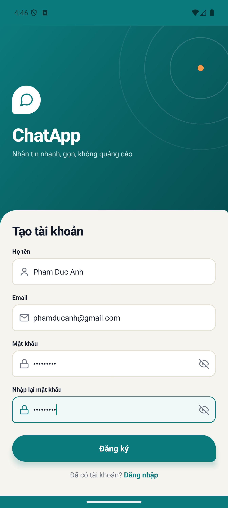
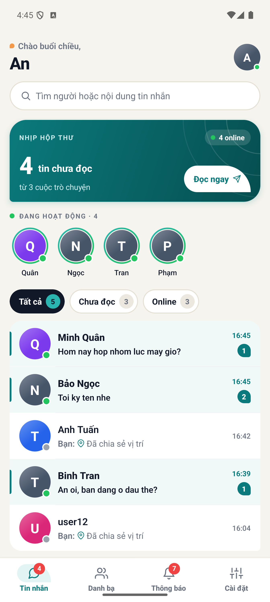
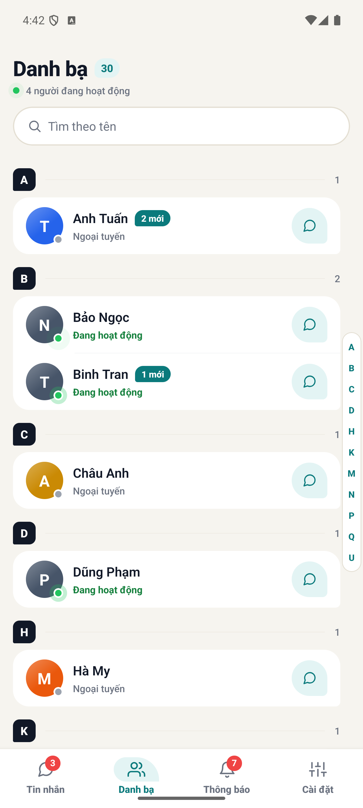
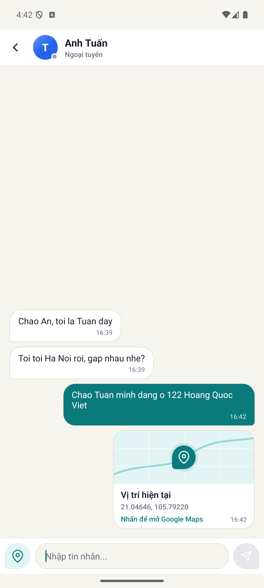
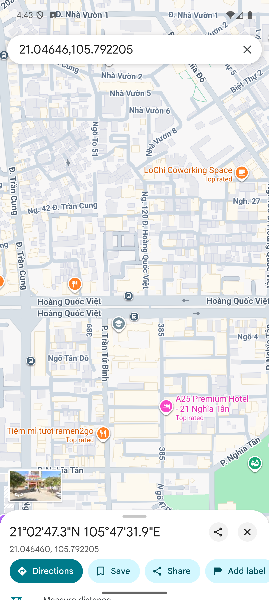

# Bài thực hành 05 - Chat 1-1 realtime với Firebase (React Native)

Sinh viên: **Phạm Đức Anh** - PTIT, Công nghệ phần mềm. Mã học phần RIPT1412-20261-02.

Phát triển tiếp ứng dụng chat của Bài 4 bằng React Native CLI (không dùng Expo). Dữ liệu mẫu được thay bằng dữ liệu thời gian thực trên Firebase (Authentication Email/Password và Realtime Database) để hai người dùng nhắn tin trực tiếp với nhau.

- Dự án Firebase: `chat-realtime-1-1`, Realtime Database ở `asia-southeast1`.
- Giao diện: `DESIGN.md` mô tả phong cách "Tín hiệu ấm" (nền kem, màu teal, vòng sóng báo trạng thái trực tuyến).

## Minh chứng các màn hình

Ảnh chụp từ máy ảo Android (Pixel 8 Pro, Android 16), lưu trong `docs/screenshots/bai05/`. Người dùng khác trong ảnh là các tài khoản thật trên Firebase do script thử nghiệm đăng nhập và gửi tin; chỉ có một máy ảo chạy ứng dụng.

### 1. Đăng ký

Họ tên, email, mật khẩu (tối thiểu 6 ký tự) và nhập lại mật khẩu. Lỗi hiện ngay dưới từng ô; lỗi từ Firebase (email đã dùng...) hiện ở khung đỏ phía trên nút. Đăng ký xong thì Firebase tự đăng nhập và vào Home.



### 2. Home có số tin chưa đọc

Thẻ tổng số tin chưa đọc, dải "Đang hoạt động", chip lọc Tất cả / Chưa đọc / Online. Mỗi dòng có ảnh đại diện, tên, tin cuối, thời gian; cuộc trò chuyện mới nhất nằm trên cùng. Số chưa đọc tăng ngay khi có tin và về 0 khi mở cuộc trò chuyện.



### 3. Danh bạ có trạng thái online

Danh sách người dùng đã đăng ký (không gồm bản thân), sắp xếp theo tên A đến Z và chia nhóm theo chữ cái đầu như danh bạ điện thoại. Chấm xanh và chữ "Đang hoạt động" cập nhật theo thời gian thực; người offline hiện "Hoạt động ... trước" hoặc "Ngoại tuyến". Có ô tìm kiếm theo tên, nhấn một người để mở chat.



### 4. Chat có tin thường và tin vị trí

Tin của mình bên phải, của người kia bên trái, mỗi tin có giờ. Ô trống hoặc chỉ có dấu cách thì nút Gửi bị vô hiệu. Danh sách tự cuộn tới tin mới nhất. Thanh tiêu đề hiện tên và trạng thái online. Nút 📍 xin quyền vị trí (từ chối thì hiện thông báo) rồi gửi một thẻ vị trí; nhấn vào thẻ thì mở Google Maps đúng toạ độ.

| Chat có tin thường và thẻ vị trí                                           | Nhấn thẻ vị trí mở Google Maps                                      |
| -------------------------------------------------------------------------- | ------------------------------------------------------------------- |
|  |  |

Máy ảo đặt vị trí cố định tại 122 Hoàng Quốc Việt (21.046461, 105.792206), nên thẻ ra `21.04646, 105.79220` và Google Maps mở đúng điểm đó.

### Phần nộp bài người dùng tự bổ sung

- Ảnh Firebase Console, Realtime Database, tab Data cho thấy dữ liệu tin nhắn (`messages`, `userChats`, `status`, `users`).
- Video 1 đến 2 phút quay hai máy ảo hoặc thiết bị chat với nhau.

## Chạy ứng dụng

Yêu cầu: Node 22.11 trở lên (theo `engines` trong `package.json`), Android Studio với ít nhất một máy ảo (nên dùng hình ảnh có Google Play để có Google Maps).

```sh
npm install
npm start
# mở terminal khác, máy ảo Android đang bật
npm run android
```

Cấu hình Firebase (Web app) nằm trong `src/services/firebase.ts`. Đây là cấu hình công khai của ứng dụng Web; việc bảo vệ dữ liệu dựa vào Authentication và Rules bên dưới.

### Chạy với hai máy ảo

```sh
emulator -list-avds
emulator -avd <tên_avd_1>
emulator -avd <tên_avd_2>
adb devices
# với mỗi máy: nối Metro và cài ứng dụng
adb -s <serial> reverse tcp:8081 tcp:8081
npm run android -- --deviceId <serial>
```

Đăng ký hai tài khoản trên hai máy rồi nhắn tin cho nhau.

### Đặt vị trí máy ảo

Máy ảo không có GPS thật. Đặt toạ độ rồi mới bấm 📍 (kinh độ trước, vĩ độ sau):

```sh
adb -s <serial> emu geo fix 105.792206 21.046461
```

Nếu thẻ vị trí đầu tiên vẫn ra toạ độ mặc định của máy ảo (37.42200, -122.08400) thì gửi lại một lần nữa.

### Tài khoản thử nghiệm

Các tài khoản tạo sẵn để có danh bạ đầy đủ: `user1@gmail.com` đến `user30@gmail.com`, mật khẩu `12345678` (tên hiển thị `user2` đến `user20`, riêng `user21` đến `user30` dùng tên tiếng Việt như Anh Tuấn, Bảo Ngọc, Minh Quân). Có thể đăng ký tài khoản riêng bằng màn Đăng ký.

## Chức năng theo đề

| Mục                    | Nội dung                                                                                                                                                                  | Vị trí mã                                                                                                    |
| ---------------------- | ------------------------------------------------------------------------------------------------------------------------------------------------------------------------- | ------------------------------------------------------------------------------------------------------------ |
| 1. Đăng ký / Đăng nhập | Đăng ký (họ tên, email, mật khẩu, nhập lại), đăng nhập, thông báo lỗi tiếng Việt, đăng xuất ở Cài đặt, giữ phiên khi mở lại app                                           | `src/features/auth`, `src/context/AuthContext.tsx`, `src/services/authService.ts`                            |
| 2. Danh bạ             | Danh sách người dùng (không gồm bản thân), online/offline realtime, tìm kiếm, mở chat                                                                                     | `src/features/contacts`, `src/context/ChatContext.tsx`, `src/services/userService.ts`, `presenceService.ts` |
| 3. Chat 1-1            | Gửi và nhận tức thì, phải/trái, có giờ, chặn tin rỗng, tự cuộn, tiêu đề tên và online                                                                                     | `src/features/chats/ChatDetailScreen.tsx`, `src/services/chatService.ts`                                     |
| 4. Gửi vị trí          | Nút 📍, xin quyền, thông báo khi từ chối, thẻ vị trí, mở Google Maps                                                                                                      | `src/services/locationService.ts`, `MessageBubble.tsx`, `MessageInput.tsx`                                   |
| 5. Home                | Danh sách cuộc trò chuyện, mới nhất trên cùng, số chưa đọc tăng ngay và về 0 khi mở chat                                                                                  | `src/features/chats/HomeScreen.tsx`, `userChats` trong RTDB                                                  |
| 6. Kỹ thuật            | React Native CLI, React Navigation, Firebase JS SDK, `@react-native-community/geolocation`, code Firebase gom trong `src/services/`, hủy listener trong cleanup của `useEffect` | `src/services/*`, `ChatDetailScreen.tsx`                                                                     |
| Thông báo              | Giữ như Bài 4 (dữ liệu mẫu cục bộ)                                                                                                                                        | `src/features/notifications`, `src/data/notifications.ts`                                                    |

Trạng thái trực tuyến: khi đăng nhập app ghi `status/{uid}` và đăng ký `onDisconnect` để server tự ghi offline khi mất kết nối. Ứng dụng ở nền quá 5 giây thì ngắt kết nối (`goOffline`) để bạn bè thấy offline; quay lại thì nối lại. Công tắc "Hiển thị trạng thái online" ở Cài đặt được lưu trên máy và giữ sau khi khởi động lại.

## Cấu trúc thư mục

```text
src/
  services/     firebase.ts, authService, userService, presenceService, chatService, locationService
  context/      AuthContext, ChatContext, NotificationContext
  navigation/   RootNavigator, MainTabs, types
  features/     auth, chats, contacts, notifications, settings
  components/   Avatar, SearchBar, ScreenHeader, EmptyState, Icon và các thành phần giao diện dùng chung
  hooks/ utils/ theme/ types/ data/
database.rules.json   luật bảo mật Realtime Database
firebase.json, .firebaserc
```

## Cấu trúc Realtime Database và luật bảo mật

`chatId = [uidA, uidB].sort().join('_')`

```text
users/{uid}                      { name }
status/{uid}                     { online, lastChanged }
messages/{chatId}/{pushId}       { from, type: 'text' | 'location', text | location{lat,lng}, createdAt }
userChats/{uid}/{peerUid}        { lastMessage, lastTime, lastFrom, unread }
```

Luật trong `database.rules.json`:

- Chỉ người đã đăng nhập mới đọc được `users` và `status`; mỗi người chỉ ghi được hồ sơ và trạng thái của chính mình. Email không lưu trong Realtime Database.
- `messages/{chatId}` chỉ hai người trong cuộc trò chuyện đọc được; chỉ được thêm tin mới (không sửa hay xóa tin cũ), `from` phải là chính người gửi, `createdAt` là giờ server, tin chữ không rỗng và tối đa 1000 ký tự.
- `userChats/{uid}` chỉ chủ sở hữu đọc được. Chủ sở hữu chỉ đặt `unread` về 0; người gửi chỉ tăng `unread` của người nhận thêm đúng 1 (dùng `increment(1)`).
- Mỗi lần gửi là một `update()` nhiều đường dẫn: tin nhắn, hai bản ghi `userChats` và `unread` của người nhận thành công cùng lúc hoặc thất bại cùng lúc.

### Deploy luật

```sh
npx -y firebase-tools@latest deploy --only database --project chat-realtime-1-1
```

Nếu mạng không dùng được IPv6 thì lệnh có thể báo hết thời gian kết nối; thử lại với `NODE_OPTIONS="--dns-result-order=ipv4first --no-network-family-autoselection"`.

## Kiểm tra mã

```sh
npx tsc --noEmit
npm run lint
npm test
```

`npm test` chỉ chạy một bài kiểm tra render cơ bản; `jest.setup.js` giả lập Firebase, AsyncStorage, geolocation và các service để bài kiểm tra không mở kết nối mạng.

## Giới hạn đã biết

- Thanh chữ cái bên phải ở Danh bạ hiển thị nhưng chạm vào chưa nhảy tới nhóm tương ứng (cuộn tay vẫn bình thường).
- Chưa kiểm tra và chưa build trên iOS; `Info.plist` đã có mô tả quyền vị trí.
- Thông báo vẫn dùng dữ liệu mẫu như Bài 4.
- Tin nhắn không có xóa, sửa hay ảnh; mỗi cuộc trò chuyện chỉ tải 200 tin gần nhất.

---

# Hướng dẫn mặc định của React Native

This is a new [**React Native**](https://reactnative.dev) project, bootstrapped using [`@react-native-community/cli`](https://github.com/react-native-community/cli).

# Getting Started

> **Note**: Make sure you have completed the [Set Up Your Environment](https://reactnative.dev/docs/set-up-your-environment) guide before proceeding.

## Step 1: Start Metro

First, you will need to run **Metro**, the JavaScript build tool for React Native.

To start the Metro dev server, run the following command from the root of your React Native project:

```sh
# Using npm
npm start

# OR using Yarn
yarn start
```

## Step 2: Build and run your app

With Metro running, open a new terminal window/pane from the root of your React Native project, and use one of the following commands to build and run your Android or iOS app:

### Android

```sh
# Using npm
npm run android

# OR using Yarn
yarn android
```

### iOS

For iOS, remember to install CocoaPods dependencies (this only needs to be run on first clone or after updating native deps).

The first time you create a new project, run the Ruby bundler to install CocoaPods itself:

```sh
bundle install
```

Then, and every time you update your native dependencies, run:

```sh
bundle exec pod install
```

For more information, please visit [CocoaPods Getting Started guide](https://guides.cocoapods.org/using/getting-started.html).

```sh
# Using npm
npm run ios

# OR using Yarn
yarn ios
```

If everything is set up correctly, you should see your new app running in the Android Emulator, iOS Simulator, or your connected device.

This is one way to run your app — you can also build it directly from Android Studio or Xcode.

## Step 3: Modify your app

Now that you have successfully run the app, let's make changes!

Open `App.tsx` in your text editor of choice and make some changes. When you save, your app will automatically update and reflect these changes — this is powered by [Fast Refresh](https://reactnative.dev/docs/fast-refresh).

When you want to forcefully reload, for example to reset the state of your app, you can perform a full reload:

- **Android**: Press the <kbd>R</kbd> key twice or select **"Reload"** from the **Dev Menu**, accessed via <kbd>Ctrl</kbd> + <kbd>M</kbd> (Windows/Linux) or <kbd>Cmd ⌘</kbd> + <kbd>M</kbd> (macOS).
- **iOS**: Press <kbd>R</kbd> in iOS Simulator.

## Congratulations! :tada:

You've successfully run and modified your React Native App. :partying_face:

### Now what?

- If you want to add this new React Native code to an existing application, check out the [Integration guide](https://reactnative.dev/docs/integration-with-existing-apps).
- If you're curious to learn more about React Native, check out the [docs](https://reactnative.dev/docs/getting-started).

# Troubleshooting

If you're having issues getting the above steps to work, see the [Troubleshooting](https://reactnative.dev/docs/troubleshooting) page.

# Learn More

To learn more about React Native, take a look at the following resources:

- [React Native Website](https://reactnative.dev) - learn more about React Native.
- [Getting Started](https://reactnative.dev/docs/environment-setup) - an **overview** of React Native and how setup your environment.
- [Learn the Basics](https://reactnative.dev/docs/getting-started) - a **guided tour** of the React Native **basics**.
- [Blog](https://reactnative.dev/blog) - read the latest official React Native **Blog** posts.
- [`@facebook/react-native`](https://github.com/facebook/react-native) - the Open Source; GitHub **repository** for React Native.
